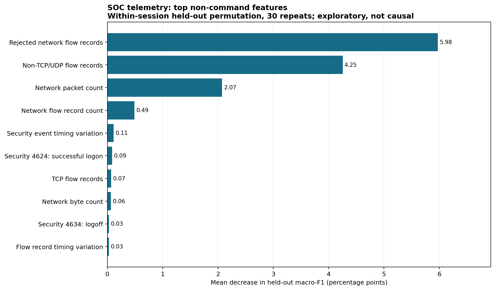

# SOC Operations Identification

## Defender-visible signal without terminal commands

This exploratory Praxis follow-on asks whether network and host logs available
to a security operations center (SOC) contain a signal that distinguishes AI
from human operators during an attack, even when terminal commands are not
available to the classifier. The results show a **promising signal in this
small laboratory dataset**, not statistically confirmed or production-ready
identification of autonomous AI advanced persistent threats (APTs). A
subsequent sensitivity audit found substantial dependence on traffic that may
reflect laboratory infrastructure; see the matched comparison below.

## Experiment

The original Study 3 contained nine attack sessions: five human and four AI.
We used non-overlapping **30-second windows** within the existing, known attack
login periods and evaluated by leaving one entire session out at a time.
Training-only scaling and class/session weighting were applied within each
fold. Of 1,900 candidate windows, 1,225 met the coverage rules: 930 human and
295 AI. Network `SKIPDATA` affected 673 candidate windows; three were outside
observed source extents, with overlap between exclusion categories.

The input combined:

- Windows Security and Sysmon event-ID counts from four consistently available
  hosts, including event counts for authentication, process creation and
  network-related activity.
- VPC flow record, packet and byte counts; protocol categories; and
  accepted/rejected flow counts.
- Available common Windows scheduled-task, System and Application event
  counts, plus IIS access-record counts.
- Five-second-bin activity, timing variation and cross-channel co-activity
  features within each 30-second window.

We did **not** delete or alter the original evidence. Terminal input/output,
reconstructed commands, and Windows command-line fields were not model
features. Event messages were used only to extract event IDs; the model also
excluded IP addresses, ports, account names, host identifiers and message
text. For time alignment, only the first recorder `start` record was parsed;
the recorder file was hashed for integrity, and prior-study login metadata
provided the time boundaries. This is not a test of finding unknown attack
periods without that metadata. Some other source channels were missing across
sessions, command-related, or experiment infrastructure and were excluded.

The classifier was XGBoost, evaluated on held-out sessions with a fixed 0.5
decision threshold.

## Result

| Model | Window | Macro-F1 | 95% session interval | AI recall | Human attack-window false-positive rate | Session accuracy | Raw permutation p | Holm-adjusted p |
|---|---:|---:|---:|---:|---:|---:|---:|---:|
| XGBoost, combined SOC features and timing | 30 seconds | **0.676** | 0.501–0.857 | **47.8%** | 13.7% | 8/9 | 0.0079 | 0.127 |

For context, logistic regression on the earlier combined SOC count features
scored macro-F1 **0.609** on the same eligible 30-second windows. XGBoost with
those counts scored **0.666**, and the XGBoost configuration with additional
channels and timing features scored **0.676**: a 0.067 absolute gain over the
logistic baseline. Model and feature changes both contribute to this
comparison; their individual effects were not established by a paired
significance test.

The 0.0079 p-value is unadjusted. After Holm correction for the 16 planned
configurations, the reported p-value is 0.127, so the result does not meet a
0.05 threshold. With nine sessions there are only 126 possible session-label
assignments; the best possible first Holm-adjusted p-value for this family is
16/126, approximately 0.127. Permutation inference also assumes exchangeable
sessions, which lab environment and collection differences may violate. The
interval resamples sessions using fixed out-of-fold predictions; it does not
capture model selection or refitting uncertainty.

## Follow-on results: AI signal or infrastructure signal?

The following fixed XGBoost models were evaluated on the same 1,225
30-second attack windows and nine held-out sessions. None of the models uses
terminal commands as features. The port-filtered model removes UDP flow
records with source or destination port 41641 or 3478, then recomputes flow
features; the host-only model excludes flow features altogether.

| Model | Macro-F1 | AI recall | Human attack-window false-positive rate | Session accuracy |
|---|---:|---:|---:|---:|
| Original combined SOC model | 0.676 | 47.8% | 13.7% | 8/9 |
| UDP port-filtered model | 0.540 | 34.2% | 25.6% | 6/9 |
| Host-only model | 0.514 | 28.5% | 25.5% | 6/9 |

The original classifier associated defender-visible telemetry with the
operator labels, but its performance was sensitive to the removal of
particular network traffic. The observed port pattern is consistent with
infrastructure traffic, including traffic using ports associated with
Tailscale and STUN, but ports do not establish which process generated it.
This raises an important alternative explanation: the classifier may partly
recognize the environment or collection setup rather than the operator's
behavior. The study cannot determine how much of the signal comes from either
source, or whether the remaining signal generalizes to another environment.

These are post hoc sensitivity analyses, not independent confirmation.
Compared with the baseline, the 95% paired session-bootstrap interval for the
macro-F1 change was -0.341 to +0.054 for port filtering and -0.396 to +0.059
for host-only telemetry. Both intervals include zero; they resample fixed
held-out predictions and omit refitting and selection uncertainty. The port
filter can remove unrelated traffic and does not eliminate all possible
infrastructure signals.

## What this means for SOC operations

The models classified windows within **known attack periods**. Their
false-positive rates describe human attack windows labeled as AI, not normal
business traffic labeled as malicious. They therefore do not measure benign
false-alert rates, find previously unknown attacks, or establish that a SOC
can deploy an AI-operator detector. The most defensible conclusion is that
the existing logs contain an exploratory label-associated signal whose
source and transferability remain uncertain.

These retrospective analyses motivate, but do not test or establish, the
H1–H3 decisions for the proposed matched Praxis study, whose hypotheses and
design differ. The original Study 3 saved results were replayed; an exact full
refit was not verified. See the [complete telemetry audit](SOC_TELEMETRY_AUDIT.md)
for traffic details, coverage limitations and additional results. The
[visibility and environment follow-on](SOC_VISIBILITY_ENVIRONMENT_RESULTS.md)
adds process-event-removal, flow-only and outside-login checks.

## Top non-command features



The figure ranks the mean decrease in pooled held-out macro-F1 when each
feature is shuffled **within each held-out session**, repeated 30 times.
The nine models were refitted and verified against the saved held-out
predictions before calculating importance. Rejected flow records,
non-TCP/UDP flow records and packet counts produced the largest decreases.
The measurements are in macro-F1 **percentage points**, not percentages of
total importance.

This is exploratory model reliance, not a causal explanation, a direction of
association with AI, or an independent validation of any feature. Shuffling
breaks feature relationships and may create unrealistic combinations;
correlated features can mask one another. Within-session shuffling does not
measure reliance on between-session differences. Network policy, background
activity, lab configuration and missing telemetry could influence the model.
Flow records are assigned by the end of their aggregation interval, not the
precise time of the underlying traffic.

## Importance of command inputs

The original Study 3's retrospective command-content ablation provides direct
evidence that command content was valuable in that experiment: its XGBoost
macro-F1 increased from **0.683 without command content to 0.857 with it**,
an absolute gain of **0.175** (Holm-adjusted p = 0.0025; interval for the gain
0.102–0.235). The original H1 rule was restated after scoring. The
command-content-removed original model still used other operator-host
behavioral features.

That paired original-study comparison is **not** a head-to-head comparison
with the SOC-only result above: the datasets, window inclusion and feature
sets differ. Therefore, the experiments show both that command content helped
the original classifier and that defender-side metadata exhibited an
exploratory signal without command content; they do not quantify the loss from
removing commands from this SOC model or establish that SOC telemetry can
replace command logs.

## Optimization and limitations

This was a fixed, exploratory model comparison, **not an Optuna
hyperparameter search**. We compared logistic regression and XGBoost, 30-,
60-, 120- and 300-second windows, additional features, and training-fold-only
SMOTE. XGBoost used 80 trees, maximum depth 3 and learning rate 0.1. SMOTE
lowered the 30-second macro-F1 from 0.676 to 0.629. Five-minute windows could
not be evaluated across all sessions because of gaps. Different window sizes
also retain different subsets, so their scores are not perfectly matched.

Further work should collect more independent human and AI sessions, include
benign SOC traffic, validate across environments, and assess unknown attack
periods and alert latency. If hyperparameters are tuned, selection must occur
within session-grouped training folds and the entire selection procedure
should be repeated during permutation testing or validated on an independent
holdout. The human false-positive rate here is for **human attack windows**,
not benign traffic, and cannot be used as a SOC false-alert rate.

## Reproducibility

The [expanded experiment runbook](../../scripts/DEFENDER_EXPANDED_EXPERIMENT.md)
details source selection, coverage and evaluation. The original command-content
comparison comes from the saved Study 3 `T_h1_restated.csv`; its reproduction
is described in the [Study 3 runbook](../../scripts/STUDY3_REPRODUCTION.md).
The chart can be regenerated from a completed private expanded experiment:

```powershell
& $python scripts\defender_feature_importance.py --experiment $output --output reports\soc_operations_identification\figures\non_command_feature_importance.png
```

The feature and prediction files contain restricted study data and must remain
outside Git. The chart contains only aggregate feature names and scores.
